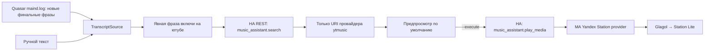

# Yandex Lite → YouTube Music

Безопасное исследование сценария 3 для Yandex Station Lite 1 (`yandexmicro`, Amlogic A113X).
Цель: финальный текст голосового запроса → Home Assistant → поиск YouTube Music в Music Assistant → Glagol → станция.

**Статус: экспериментальный рабочий прототип.** Финальный текст Quasar подтверждён
в штатном `maind.log` без перехвата микрофона. Поиск YouTube Music и слышимое
воспроизведение подтверждены на HA и MA 2.11.0 BETA. Ограниченный наблюдатель
начинает с конца журнала, принимает только явные музыкальные фразы, ждёт возврата
Алисы в `IDLE` и удаляет быстрые дубли.

## Архитектура



Вся логика Python выполняется на Mac/сервере, не на Buildroot. Станция получает только короткие команды чтения через уже настроенный ADB/SSH. Прошивка, rootkeeper и настройки Алисы не изменяются. Микрофон, аудиоустройства, память процессов и IPC-потоки не перехватываются.

Интерфейсы `TranscriptSource`, `Catalog`, `Player` разделяют исследование и воспроизведение. Наблюдатель запускается на внешнем хосте явно; постоянного автозапуска пока нет.

## Локальный запуск

Python 3.9+, внешние библиотеки для выполнения и тестов не нужны. Из каталога репозитория:

```sh
python3 -m station_music.cli 'Алиса, включи на ютубе Queen' --demo
python3 -m unittest discover -s tests -v
```

Демонстрационный трек синтетический; сеть и колонка не используются.
Можно установить CLI в отдельное окружение через `python3 -m pip install .`.

## Подключение настоящего HA/MA

1. Установить MA Server и официальную интеграцию Music Assistant в HA.
2. В MA настроить YouTube Music по [актуальной инструкции](https://www.music-assistant.io/music-providers/youtube-music/). Сейчас требуются платная подписка, cookie и PO Token service. Учётные данные остаются в MA.
3. Добавить **Yandex Station** в MA Player Providers, авторизоваться владельцем станции. Для текущих прошивок станции использовать MA 2.11.0+ и проверить ручное воспроизведение на слух. Экспериментальные `Intercept native playback` и `Voice control integration` оставить выключенными.
4. В HA выбрать `media_player` именно из интеграции MA для этой станции, а не одноимённую сущность AlexxIT. Получить `config_entry_id` MA через выбор конфигурации в Developer Tools → Actions → `music_assistant.search` → YAML.
5. Задать `HA_URL`, `HA_TOKEN`, `MA_CONFIG_ENTRY_ID`, `MA_PLAYER_ENTITY`, точный
   `YT_PROVIDER` и при наличии штатной интеграции `STATION_NATIVE_ENTITY` как
   переменные окружения по `.env.example`. Последняя сущность ставится на паузу
   перед запуском MA, иначе старая очередь радио или исполнителя может продолжить
   играть. Файл `.env` автоматически не читается. Токен не добавлять в Git,
   аргументы команд или чат. Для интерактивного безопасного ввода в zsh:
   `read -s 'HA_TOKEN?HA token: '; export HA_TOKEN`.
6. Запустить предпросмотр:

```sh
python3 -m station_music.cli 'Алиса, включи на ютубе Queen Bohemian Rhapsody'
```

Для HTTP на доверенной локальной сети явно добавить `--allow-http`; предпочтителен HTTPS с проверяемым сертификатом. Redirect запрещён, чтобы не переслать токен другому адресу.

Для отправки команды воспроизведения добавить `--execute`. Это **заменит очередь MA** и может прервать текущий звук. Прототип берёт первый подходящий результат, не пытается определить намерение из произвольной речи. `submitted` означает успешный ответ сервиса, а не доказательство слышимого звука. При сетевом таймауте результат может быть неопределённым; автоматического повтора нет.

После ручной проверки запустить голосовой наблюдатель на доверенном хосте, где
доступны `adb`, переменные HA/MA и соединение с колонкой:

```sh
python3 -m station_music.watch --adb-serial STATION_IP:5555 --allow-http \
  --token-file work/ha_token
```

Поддерживается обычная команда «Алиса, включи Noize MC Страна дождей», а также
уточнённые формы «включи песню …» и «включи группу …». Мост дождётся окончания
ответа штатной Алисы и запустит результат из YouTube Music. Очевидные команды
устройств — свет, телевизор, чайник, пылесос, климат и другие частые категории —
игнорируются. Уточнённая музыкальная форма остаётся безопаснее для неоднозначных
названий. Старые префиксы сохранены для совместимости.

Наблюдатель сам восстанавливает ADB-подключение после перезагрузки колонки и
продолжает с конца журнала, не повторяя старые команды. Установка через systemd
также перезапускает процесс при любом неожиданном выходе.

Поиск HA глобальный; фильтрация оставляет только прямые URI выбранного экземпляра
YouTube Music, например `ytmusic--INSTANCE_ID://track/...`. Идентификатор экземпляра
регистрозависим. Библиотечные URI отбрасываются, так как HA не возвращает надёжное
происхождение провайдера. Возможен ложный отказ при наличии трека в библиотеке или
вне первых 25 результатов. Мы не подставляем URL страницы YouTube вместо аудиопотока.

## Исследование станции только чтением

```sh
adb -s STATION_IP:5555 shell sh < scripts/probe_station.sh
adb -s STATION_IP:5555 shell sh < scripts/log_signals.sh
# Альтернативный транспорт при настроенной SSH-аутентификации:
ssh -p 2222 root@STATION_IP sh < scripts/log_signals.sh
```

Скрипты не копируются на станцию, не пишут файлы, не подключаются к внутренним сокетам. Читаются только известные журналы, максимум последние 64 KiB за проход; выводятся счётчики, не текст. Обычные системные журналы могут зафиксировать сам факт подключения ADB/SSH.

См. [план экспериментов](docs/research.md), [проверенные источники и API](docs/sources.md) и [наблюдения на устройстве](docs/device-observations.md).

## Границы первой версии

- Наблюдатель экспериментальный: перед автозапуском нужна серия проверок распознавания, отмены, ротации журнала и перезапуска станции.
- Нет прямого клиента Glagol: аутентификацией, форматом потока и воспроизведением занимается существующий MA-провайдер.
- Голосовой режим требует явного префикса; финальность, ожидание `IDLE`, запуск с EOF и подавление быстрых дублей реализованы.
- Для проверки звука нужны настроенные HA/MA, YouTube Music и доступный со станции адрес MA. Сетевые API внешних проектов могут меняться; preflight проверяет доступность сервисов, но не их полную совместимость.

## Остановка и откат

CLI одноразовый; исследовательские скрипты заканчиваются сами. Остановить звук можно в MA. Удаление проекта не требует отката станции: ничего не устанавливается и автозапуск не меняется. После `--execute` предыдущая очередь автоматически не восстанавливается.
